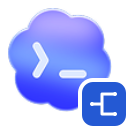
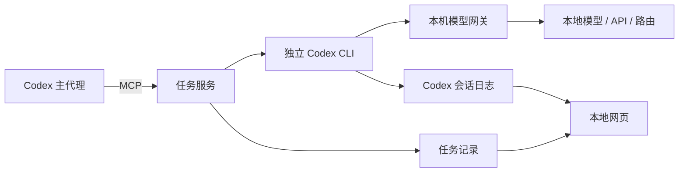

<p align="center"></p>

# codex-exo-subagent-mcp

为 Codex 接入外部子代理模型，并提供本地会话工作区。支持本地部署、直连 API 和模型路由，保留主代理的官方模型配置。

**零 npm 运行依赖 · Node.js 24+ · Windows 为当前验证平台**

## 功能

- **任务管理**：同步或后台执行、进度查询、等待、取消、继续会话。
- **模型配置**：通过网页添加连接，在统一模型列表中管理已添加模型与获取到的候选模型、默认模型和每个模型的思考设置；保存后可单独测试。
- **接口接入**：Responses API 直接转发；OpenAI 兼容 Chat Completions 在本机适配，包括流式文本、工具调用和工具结果。
- **会话页面**：左侧项目与最近会话，右侧消息与执行记录，支持搜索、置顶、重命名、分页和导出。最近列表用单个状态点表示运行状态；会话标题集中在面包屑，会话信息不再显示固定来源说明。
- **执行记录**：同一终端进程的空 `write_stdin` 轮询不单独显示，新增输出合并回原命令卡片；有真实输入的 `write_stdin` 仍保留。命令卡片展开仅显示输出，右上角支持复制完整输出；原始 API 记录、导出和完整输出不变。
- **本地存储**：仅显示本 MCP 登记的会话；模型密钥支持 Windows 当前用户加密保存或环境变量认证。

## 快速开始

准备 Node.js 24+、Git，以及支持 `codex exec --json` 和 `codex exec resume` 的 Codex CLI。

```powershell
git clone https://github.com/CandyRGB/codex-exo-subagent-mcp.git
cd codex-exo-subagent-mcp

# 启动本地服务并打开模型配置页面
node open-viewer.mjs --settings
```

打开 [模型与连接](http://127.0.0.1:43187/#/settings/models)，点击“添加连接”，填写 API 根地址和认证方式。在统一模型列表中添加模型 ID、指定默认模型，然后保存并按需测试。连接卡片上的“设为默认连接”用于选择新任务使用的连接。

初始配置保留 `workbuddy` / `deepseek-v4.1-flash` 作为兼容入口。如果本机没有这个 Codex profile，直接在页面新增自己的连接并设为默认即可。

随后在 **仓库目录** 中注册 MCP：

```powershell
$entry = Join-Path (Get-Location) 'server.mjs'
codex mcp add codex-subagent -- node $entry
```

重新连接 MCP 或重启 Codex，让客户端读取工具列表。之后修改默认连接会在新任务开始时读取；续聊继续使用原来的连接和模型。

> [!NOTE]
> 不需要 `npm install`。运行数据默认写在仓库的 `state/` 中，该目录已被 Git 忽略。原生 Codex 会话日志仍由 Codex 管理。

## 配置模型

| 接入方式 | 地址示例 | 协议 |
| --- | --- | --- |
| Ollama | `http://127.0.0.1:11434/v1` | Chat Completions |
| LM Studio | `http://127.0.0.1:1234/v1` | Chat Completions |
| vLLM | `http://127.0.0.1:8000/v1` | Chat Completions |
| API 或代理路由 | 服务商提供的 API 根地址 | Responses 或 Chat Completions |

模型服务需要已在本机、局域网或远端运行，并支持所选 API。模型应支持函数/工具调用。其他原生协议（例如 Anthropic Messages）需要经过兼容网关。

认证支持无需认证、环境变量，以及 Windows DPAPI 加密保存的 API Key。认证头默认为 `Authorization: Bearer ...`，也可改为 `X-API-Key` 等名称。非 Windows 环境请使用环境变量；其他平台的完整运行流程尚未验证。

“获取模型列表”是可选操作，也可以手动填写模型 ID；模型 ID 以手工填写或服务实际返回为准，不内置厂商预设。已添加模型和获取到的候选模型统一在列表中管理，可指定默认模型、进入单个模型的思考设置或移除模型。底部“保存”是主要操作；“测试”是独立次操作，只使用已保存的设置，有未保存修改时需先保存。测试会发送一条小型推理请求，检查流式结束及基础工具调用，可能计入上游服务用量。

接入方式分为“模型 API 连接”和“已有 Codex profile”。API 地址、协议、认证和模型 ID 由用户手动填写；默认模型只在编辑区的统一模型列表中设置，连接卡片只保留默认连接标记和“设为默认连接”操作。网页管理的 API 连接在每次启动子 CLI 时通过 `--model` / `-c` 传入参数，不自动写入用户的 Codex 配置。已有 profile 可通过名称引用，是否可用需要运行实际任务验证。

### 思考参数

连接默认的思考设置在高级设置中配置。思考强度可直接填写服务接受的原始值，例如 `none`、`minimal`、`low`、`medium`、`high`、`xhigh`、`max` 或自定义值；不按厂商名称自动套用参数，也不使用厂商预设。留空表示不发送该项，让服务决定默认行为，`none` 则是一个明确发送的值，是否表示关闭由服务定义。

每个模型的思考设置从统一模型列表中的模型行进入；未单独设置的模型沿用连接默认值。启用单模型设置后，该模型使用整组独立设置，空项目不会继承连接参数。“获取模型列表”若返回档位元数据，会提供输入建议，不会自动填入或修改设置。模型清单接口未提供元数据时仍可手动填写。

| 参数结构 | 强度 | 开关／模式 | 思考预算 |
| --- | --- | --- | --- |
| 接口标准强度 | Responses 的 `reasoning.effort`，或 Chat 的 `reasoning_effort` | `disabled` 转为 `none`；`enabled` 需填写具体强度 | 没有通用预算字段 |
| thinking 兼容扩展 | 同所选 Responses / Chat 协议 | `thinking.type`，如服务支持的 `adaptive` | `thinking.budget_tokens` |
| reasoning 兼容扩展 | `reasoning.effort` | `reasoning.enabled` 布尔值 | `reasoning.max_tokens`，与强度二选一 |

扩展结构仅供明确支持相应字段的兼容服务使用，不会把原生 Claude Messages 或 Gemini GenerateContent 自动转换为 Codex 协议。页面会预览实际发送的思考参数。服务最终校验档位及模式是否合法；互相冲突的本地设置会在保存时被拒绝。

API 连接的思考参数统一由网关按实际请求的模型注入，覆盖 CLI 继承的强度；自定义值不会被当作 Codex 的执行模式。已有 profile 类型继续使用自己的配置。旧版连接的 `reasoning_effort` 会继续作为连接默认值。升级后重新连接一次 MCP，加载新的启动逻辑。

已保存的 API 连接可以在“更多”菜单中“导出为 profile”；“移除连接”也在该菜单中。弹窗提供配置预览、保存路径、下载文件和启动命令，供用户在终端手动使用 Codex CLI 0.134.0+。导出不自动安装或覆盖配置，不包含 API Key 或网关令牌。导出的 profile 仍通过本机网关访问原连接，启动命令会启动网关并从本地文件读取令牌；连接和网关需保留，地址、协议或认证方式变化后需要重新导出。手动启动的 CLI 会话不纳入本页面的 MCP 会话列表。

> [!IMPORTANT]
> 网页只监听本机回环地址。API 连接任务通过同一个本机模型网关运行，因此任务执行时服务需要保持运行。关闭浏览器窗口不会停止服务。

## 在 Codex 中使用

例如告诉 Codex：

> 使用配置好的子代理在后台检查这个项目，完成后报告修改文件和验证结果。

MCP 提供一个工具 `codex_subagent`，通过 `action` 选择操作：

| action | 用途 |
| --- | --- |
| `run` | 同步执行，默认操作 |
| `start` | 后台启动并返回任务编号 |
| `status` / `wait` | 查询进度或有限时间等待 |
| `resume` | 在原会话中继续执行，产生新的任务编号 |
| `cancel` | 终止对应任务的进程树 |
| `result` / `list` | 分页读取结果或列出任务 |
| `models` | 列出配置的连接和模型 ID，不包含密钥 |
| `viewer` | 返回本地工作区地址 |

省略 `connection_id` 和 `model` 时使用网页设置。也可以先调用 `models`，再明确选择连接和模型：

```json
{"action":"start","prompt":"检查项目并报告验证结果","cwd":"C:\\path\\to\\project","sandbox":"workspace-write"}
{"action":"wait","job_id":"<任务编号>","wait_sec":25}
{"action":"resume","job_id":"<任务编号>","prompt":"继续检查第二个输入"}
```

主代理只接收任务状态和有限长度的结果。完整记录可从网页查看；子代理不会自动得到主聊天的全部上下文。

## 运行原理



任务服务和网页/网关服务是独立进程。正常断开 MCP 会中断该连接仍在运行的任务；网页服务可以继续查看已保存的记录。已有 Codex profile 类型的连接直接沿用其原路由。

## 测试

```powershell
npm test
```

46 项自动检查覆盖任务生命周期、会话范围、配置操作、密钥加密、profile 引用与导出、路由固定、网络错误提示、按模型思考参数、思考模式下的连接测试、认证与流式工具协议适配。

```powershell
# 真实 Codex CLI + 本地确定性模型接口，验证文件写入、shell、续聊及导出 profile
npm run test:cli

# 可选：调用实际配置的模型两轮，可能消耗该模型的额度
npm run test:live
```

浏览器外观自动验收尚未完成；接口、静态资源和前端绑定已经检查。

## 环境与存储

常用环境变量：

| 变量 | 默认值 / 用途 |
| --- | --- |
| `CODEX_SUBAGENT_STATE_DIR` | 入口旁的 `state` |
| `CODEX_SUBAGENT_VIEWER_PORT` | `43187` |
| `CODEX_SUBAGENT_MAX_CONCURRENT` | 每个 MCP 进程最多 `2` 个任务 |
| `CODEX_SUBAGENT_MAX_OUTPUT_CHARS` | 每页结果 `4000` 个 UTF-16 字符 |
| `CODEX_SUBAGENT_CODEX_BIN` | Windows 自动寻找桌面端 CLI，其他情况使用 PATH 中的 `codex` |
| `CODEX_SUBAGENT_PROFILE` / `CODEX_SUBAGENT_MODEL` | 初始化兼容连接时使用的 profile / 模型 |

同一个端口只能对应一个状态目录。已有安装占用端口时，可以为新实例指定其他端口，或明确共享同一个状态目录；MCP 与网页需使用相同设置。

`state/`、会话记录、模型配置、加密凭据、网关令牌及测试产物均不提交。更多参数、生命周期和限制见 [完整参考](docs/REFERENCE.md)。
