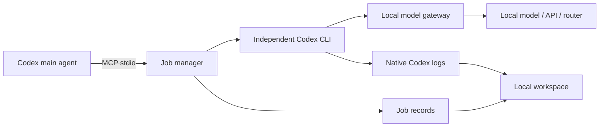

<div align="center">
  

  # codex-exo-subagent

  *Give Codex a second worker that runs on a model you choose*

  
  
  

  [English](README.md) | [简体中文](README.zh-CN.md)

  [Features](#features) · [Requirements](#requirements) · [Quick start](#quick-start) · [Model connections](#model-connections) · [The tool](#the-codex_subagent-tool) · [Local workspace](#local-workspace) · [Reference](docs/REFERENCE.md)

</div>

An MCP server that hands work from your main Codex session to an independent Codex CLI process. The child agent runs on a **model connection you configure in a local web page** — a local runtime such as Ollama, vLLM or LM Studio, a hosted API, a router, or an existing Codex profile. Your official Codex model, profile and credentials are left untouched.

Jobs are tracked from start to finish: run them in the background, poll progress, cancel the process tree, and resume the same Codex session later. A loopback-only workspace shows the full transcript of every session this server has registered.

## Features

- **One tool, full lifecycle.** `codex_subagent` covers synchronous runs, background starts, progress and bounded waits, cancellation, session continuation, paginated results, task listing and connection discovery.
- **Two connection types.** Point at a Responses API, or at an OpenAI-compatible Chat Completions endpoint that the built-in gateway translates on the fly.
- **Per-model control.** Set the context window, output cap and reasoning effort per model, and override the effort inherited from the CLI on every request.
- **Credentials stay local.** The child process only ever sees a gateway token. API keys live in Windows DPAPI-encrypted storage or an environment variable, and are redacted from every surfaced error.
- **Readable transcripts.** A local viewer merges native Codex rollout logs with the server's own history, folding empty terminal polls into one command card and offering full tool output on demand.
- **Zero dependencies.** No `npm install`, no build step — plain ES modules on Node.js 24+.

## Requirements

- **Node.js 24** or newer.
- **Codex CLI** with `codex exec --json` and `codex exec resume` support. Profile export targets Codex CLI 0.134.0+.
- **A model endpoint** that supports function or custom tool calling. For agent work, tool calling is not optional.
- **Windows 11** is the verified platform. Other systems can run the project, but the full flow is untested there; encrypted key storage requires Windows.

## Quick start

```powershell
git clone https://github.com/CandyRGB/codex-exo-subagent-mcp.git
cd codex-exo-subagent-mcp

# Start the local workspace and open the model settings page
node open-viewer.mjs --settings
```

In **Models & connections** (模型与连接), choose **Add connection**, enter an API base URL and authentication, add one or more model IDs, pick the default model, then save and test it.

The first launch starts with an empty connection list. Add an API connection or choose an existing local Codex profile. The first enabled connection becomes the default.

Register the MCP server from the repository root:

```powershell
$entry = Join-Path (Get-Location) 'server.mjs'
codex mcp add codex-subagent -- node $entry
```

Reconnect the MCP server or restart Codex so the client reloads the tool list. Default-connection changes are picked up by the next task; resumed sessions stay on their original connection and model.

> [!NOTE]
> There is no `npm install` step. Runtime data is written to `state/` next to the entry point and is git-ignored. Native Codex session logs remain under `CODEX_HOME`.

## Model connections

| Target | Base URL example | Protocol |
| --- | --- | --- |
| Ollama | `http://127.0.0.1:11434/v1` | Chat Completions |
| LM Studio | `http://127.0.0.1:1234/v1` | Chat Completions |
| vLLM | `http://127.0.0.1:8000/v1` | Chat Completions |
| Hosted API or router | the provider's API root | Responses or Chat Completions |

Responses requests are proxied upstream as SSE streams. Chat Completions requests are translated locally: message history, function and custom tools, namespace tools, streaming deltas, usage and `previous_response_id` continuation are all handled by the gateway. Native protocols such as Anthropic Messages need a compatible gateway in front of them.

Authentication supports no auth, an environment variable, or a stored API key. The header defaults to `Authorization: Bearer …` and can be renamed (`X-API-Key`, for example). Keys saved in the editor are encrypted with DPAPI under the current Windows user in `state/config/credentials.json`; on other platforms, use an environment variable.

Each model row accepts an optional context window and maximum output token count. The launcher passes the context window to Codex, and the gateway caps upstream `max_output_tokens` at the configured maximum.

### Reasoning settings

The model dialog offers three schemes:

- **Service default** — nothing is sent, so the upstream decides the effort.
- **Service-declared** — levels are read from the provider's model list with **Read levels**.
- **Custom** — you type any raw value the service accepts.

For API connections the gateway injects the setting on the actual request model and drops the effort inherited from the CLI, including when the configured value is intentionally blank. Raw values are never treated as Codex execution modes. Profile connections keep their own TOML configuration.

### Testing and export

**Check** calls `/models` with the current draft. **Test model** sends one inference request with the draft settings; **Test connection** uses the saved configuration. Both inference tests verify streaming completion and a real tool call, and may count toward provider usage.

Any saved API connection can be exported from the **More** menu as a Codex CLI profile. The dialog shows the generated `<name>.config.toml`, the target path and terminal launch commands. Nothing is installed or overwritten, no API key or gateway token is embedded, and the launch command starts the local gateway and reads its token from the state directory. Re-export after changing an endpoint, protocol or auth mode. Manually launched CLI sessions do not appear in the viewer.

## The `codex_subagent` tool

| Action | Key inputs | Behavior |
| --- | --- | --- |
| `run` | `prompt` | Wait for the agent to finish. Default action. |
| `start` | `prompt` | Start in the background and return a `job_id`. |
| `status` | `job_id` | State, elapsed time, event and tool counts. No reply body. |
| `wait` | `job_id`, `wait_sec` | Wait up to 30 seconds; a timeout does not cancel the task. |
| `cancel` | `job_id` | Terminate the child process tree and report the real terminal state. |
| `resume` | `job_id`, `prompt` | Continue the recorded Codex session; returns a new `job_id`. |
| `result` | `job_id`, `offset` | Read a page of the saved final reply. |
| `list` | `limit` | Recent tasks, newest first. |
| `models` | `connection_id` | Configured connections and model IDs, never credentials. |
| `viewer` | — | URL of the local workspace. |

```json
{"action":"start","prompt":"Inspect the failing build and fix the cause. Run the relevant check and report the changed files.","cwd":"C:\\path\\to\\project","sandbox":"workspace-write"}
{"action":"wait","job_id":"<job_id>","wait_sec":25}
{"action":"resume","job_id":"<job_id>","prompt":"Now verify the fix against the second input."}
```

Omit `connection_id` and `model` to use the website default, or read `models` first and choose explicitly.

> [!IMPORTANT]
> The child agent does not inherit the parent conversation. Write self-contained prompts with file paths, constraints and acceptance criteria. Use `resume` when the child needs its own earlier turns instead of copying a long transcript back through the main model. Concurrent turns on one Codex session are blocked.

## How it works



The MCP stdio server and the viewer/gateway are separate processes. The viewer is started on demand and survives MCP disconnects, so saved records stay readable; the gateway must be running while endpoint-backed tasks execute. Closing the browser window does not stop either service.

A normal MCP disconnect stops the tasks owned by that connection and marks them `interrupted`, because tasks are owned by a live process rather than a daemon. Stale records whose owning PID is gone are marked interrupted when read. Resume any task whose `session_id` was recorded.

## Local workspace

Open `http://127.0.0.1:43187`, or run `node open-viewer.mjs` to launch it in your browser.

Sessions are grouped by working directory under **Projects**, with a title-only recent list ordered by update time. A session view shows user instructions, agent replies, commands and tool output, and supports search, pinning, renaming the display title, loading earlier messages and JSON export. Consecutive commands collapse into a single group with per-command rows and edge-to-edge output; empty `write_stdin` polls from one terminal process fold into the original command card, while calls carrying real input stay separate. Tool output previews stop at 64,000 characters, with a full-output download and complete output inside exports.

Only sessions registered by this server are listed — no imports, no discovery by provider. Native Codex rollout logs (JSONL and Zstandard) are the primary source, with the server's own `history.jsonl` as a fallback when a rollout is unavailable. System and developer context and encrypted reasoning records are omitted from the transcript. Renaming and pinning change display metadata only; native logs are untouched.

The interface is Chinese-language and binds to loopback only. `CODEX_SUBAGENT_VIEWER_ENABLED=false` disables automatic startup for that MCP process, and `--no-open` prints the URL without launching a browser.

## Tests

```powershell
npm test
```

50 checks run against a local fixture with no provider contact. They cover job lifecycle and termination, bounded results and pagination, usage reporting, persistence and resume, session locking, timeouts, concurrency, cancellation, disconnect cleanup, connection validation, encrypted credentials, profile editing and export, route fingerprinting, error message quality, per-model reasoning injection, and authentication plus streaming tool-call translation.

```powershell
# Real Codex CLI against a deterministic local Chat Completions fixture:
# real file write, shell command, session continuation and profile export
npm run test:cli

# Optional: set CODEX_SUBAGENT_PROFILE to a local profile before running two live turns
npm run test:live
```

## Configuration

| Variable | Default |
| --- | --- |
| `CODEX_SUBAGENT_STATE_DIR` | `state` next to the entry point |
| `CODEX_SUBAGENT_VIEWER_PORT` | `43187` |
| `CODEX_SUBAGENT_VIEWER_ENABLED` | `true`; set `false` to skip the viewer |
| `CODEX_SUBAGENT_MAX_CONCURRENT` | `2` per MCP process, maximum 16 |
| `CODEX_SUBAGENT_MAX_OUTPUT_CHARS` | `4000` UTF-16 characters per page, 256–16000 |
| `CODEX_SUBAGENT_CODEX_BIN` | Newest installed desktop Codex build on Windows, otherwise `codex` on `PATH` |
| `CODEX_SUBAGENT_PROFILE` | Unset. Optional profile for calls without a saved default connection. |
| `CODEX_SUBAGENT_MODEL` | Unset. Optional model override for direct profile calls. |
| `CODEX_SUBAGENT_MAX_DEPTH` | `2` |
| `CODEX_HOME` | `~/.codex` |

Execution timeouts default to 900 seconds and accept 1–86,400. One port maps to one state directory: use a different port for a second instance, or share the state directory deliberately — the MCP server and the viewer must agree on both settings.

Model settings live in `state/config/models.json`. They are re-read for every new task, so switching the default connection does not require an MCP restart. Changing a connection's endpoint, protocol or auth mode invalidates its route fingerprint; start a new task or restore the original route rather than resuming.

## Security and storage

The workspace binds to `127.0.0.1`, validates the `Host` and `Origin` headers, sends a restrictive CSP, and compares the gateway bearer token in constant time. Sensitive routes additionally require a same-origin fetch. Upstream keys never reach the child CLI — it receives `SUBAGENT_GATEWAY_TOKEN` for the local gateway only — and error messages are scrubbed of bearer tokens, `sk-…` keys and secret values before display.

`state/` holds job metadata, visible conversation and tool history, final replies, model configuration, encrypted credentials, the gateway token and viewer metadata. None of it is committed, and nothing is deleted automatically. The child runs with `mcp_servers.codex-subagent.enabled=false` so it cannot recursively start another bridge; prompts are delivered over stdin rather than the command line.

See [docs/REFERENCE.md](docs/REFERENCE.md) for the complete action schema, gateway behavior, lifecycle rules and limitations.
