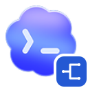
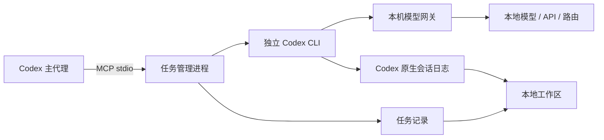

<div align="center">
  

  # codex-exo-subagent

  *让 Codex 拥有一个跑在自选模型上的第二执行者*

  
  
  

  <a href="README.md"></a>

  [功能](#功能) · [环境要求](#环境要求) · [快速开始](#快速开始) · [模型连接](#模型连接) · [工具调用](#codex_subagent-工具) · [本地工作区](#本地工作区) · [完整参考](docs/REFERENCE.md)

</div>

一个把主 Codex 会话中的工作交给独立 Codex CLI 进程的 MCP 服务。子代理运行在**你在本地网页里配置的模型连接**上——可以是 Ollama、vLLM、LM Studio 这类本地服务，也可以是托管 API、路由服务或已有的 Codex profile。官方 Codex 的模型、profile 与凭据不受影响。

任务从启动到结束都有记录：后台执行、查询进度、按时间等待、终止进程树、稍后继续同一会话。一个只监听回环地址的工作区会呈现本服务登记过的全部会话内容。

## 功能

- **一个工具，覆盖完整生命周期。** `codex_subagent` 支持同步执行、后台启动、进度与限时等待、取消、续聊、分页读取结果、列出任务和查询连接。
- **两类连接方式。** 直连 Responses API，或接入 OpenAI 兼容的 Chat Completions 接口，由内置网关实时转换。
- **细到单个模型的参数。** 每个模型可设置上下文窗口、最大输出和思考强度，并在每次请求中覆盖 CLI 继承的强度。
- **凭据只留在本机。** 子进程只拿到网关令牌；API Key 存放在 Windows DPAPI 加密存储或环境变量中，所有对外错误都会脱敏。
- **会话可读。** 本地工作区合并 Codex 原生会话日志与本服务自己的记录，把空轮询折叠进原命令卡片，需要时再展开完整输出。
- **零依赖。** 不需要 `npm install`，没有构建步骤，Node.js 24+ 上直接运行 ES 模块。

## 环境要求

- **Node.js 24** 或更高版本。
- **Codex CLI**，需支持 `codex exec --json` 与 `codex exec resume`。导出 profile 面向 Codex CLI 0.134.0+。
- **可用的模型服务**，支持函数调用或自定义工具调用。做代理任务时工具调用不是可选项。
- **已验证平台为 Windows 11。** 其他系统可以运行，但完整流程尚未验证；加密保存 API Key 需要 Windows。

## 快速开始

```powershell
git clone https://github.com/CandyRGB/codex-exo-subagent-mcp.git
cd codex-exo-subagent-mcp

# 启动本地工作区并打开模型设置页
node open-viewer.mjs --settings
```

在 **模型与连接** 中点击 **添加连接**，填写 API 根地址和认证方式，添加一个或多个模型 ID，指定默认模型，然后保存并按需测试。最后把该连接设为默认，供新任务使用。

首次启动会生成一条 `workbuddy` / `deepseek-v4.1-flash` 的 profile 连接，避免页面为空。若本机没有这个 profile，直接新增自己的连接并设为默认即可，忽略这条初始记录。

在仓库目录中注册 MCP：

```powershell
$entry = Join-Path (Get-Location) 'server.mjs'
codex mcp add codex-subagent -- node $entry
```

重新连接 MCP 或重启 Codex，让客户端读取工具列表。修改默认连接会在下一个任务开始时生效；续聊继续使用原来的连接和模型。

> [!NOTE]
> 不需要 `npm install`。运行数据写在入口旁的 `state/`，该目录已被 Git 忽略。Codex 原生会话日志仍由 `CODEX_HOME` 管理。

## 模型连接

| 接入目标 | 地址示例 | 协议 |
| --- | --- | --- |
| Ollama | `http://127.0.0.1:11434/v1` | Chat Completions |
| LM Studio | `http://127.0.0.1:1234/v1` | Chat Completions |
| vLLM | `http://127.0.0.1:8000/v1` | Chat Completions |
| 托管 API 或路由 | 服务商提供的 API 根地址 | Responses 或 Chat Completions |

Responses 请求以 SSE 流原样转发到上游。Chat Completions 请求在本地转换：消息历史、函数工具与自定义工具、命名空间工具、流式增量、用量统计和 `previous_response_id` 续接都由网关处理。Anthropic Messages 等原生协议需要先经过兼容网关。

认证支持无需认证、环境变量和已保存的 API Key。认证头默认 `Authorization: Bearer …`，也可改为 `X-API-Key` 等名称。页面中保存的密钥以当前 Windows 用户的 DPAPI 加密写入 `state/config/credentials.json`；其他平台请使用环境变量。

每个模型行可选填上下文窗口与最大输出 Token 数。启动子 CLI 时会把上下文窗口传给 Codex，网关则按配置的上限截断上游 `max_output_tokens`。

### 思考参数

模型弹窗提供三种档位方案：

- **服务默认**：不发送任何参数，由上游决定强度。
- **服务声明**：通过 **读取档位** 从服务商的模型列表获取候选值。
- **自定义**：填写服务支持的任意原始值。

API 连接的参数由网关按实际请求的模型注入，并清除 CLI 继承的强度，包括把配置值留空的情况。原始值不会被当作 Codex 的执行模式。profile 连接继续使用自己的 TOML 配置。

### 测试与导出

**检查** 使用当前草稿请求 `/models`；**测试模型** 用草稿参数发送一次推理请求；**测试连接** 使用已保存的配置。两次推理测试都会验证流式结束和真实工具调用，可能计入服务用量。

已保存的 API 连接可在 **更多** 菜单中导出为 Codex CLI profile。弹窗展示生成的 `<name>.config.toml`、目标路径和终端启动命令。导出不会安装或覆盖任何文件，不包含 API Key 或网关令牌，启动命令会拉起本地网关并从状态目录读取令牌。修改地址、协议或认证方式后需要重新导出。手动启动的 CLI 会话不会出现在本页面的会话列表中。

## `codex_subagent` 工具

| action | 主要参数 | 行为 |
| --- | --- | --- |
| `run` | `prompt` | 等待代理完成，默认操作。 |
| `start` | `prompt` | 后台启动并返回 `job_id`。 |
| `status` | `job_id` | 返回状态、耗时、事件与工具计数，不含回复正文。 |
| `wait` | `job_id`、`wait_sec` | 最多等待 30 秒；等待超时不会取消任务。 |
| `cancel` | `job_id` | 终止子进程树并报告真实的终态。 |
| `resume` | `job_id`、`prompt` | 继续已记录的 Codex 会话，返回新的 `job_id`。 |
| `result` | `job_id`、`offset` | 分页读取已保存的最终回复。 |
| `list` | `limit` | 最近的任务，按时间倒序。 |
| `models` | `connection_id` | 已配置的连接与模型 ID，不含凭据。 |
| `viewer` | — | 本地工作区地址。 |

```json
{"action":"start","prompt":"检查失败的构建并修复原因，运行相关验证并报告改动文件。","cwd":"C:\\path\\to\\project","sandbox":"workspace-write"}
{"action":"wait","job_id":"<任务编号>","wait_sec":25}
{"action":"resume","job_id":"<任务编号>","prompt":"现在用第二个输入验证这次修复。"}
```

省略 `connection_id` 与 `model` 时使用网页中的默认设置；也可以先读 `models`，再明确指定连接与模型。

> [!IMPORTANT]
> 子代理不会自动继承主会话的上下文。请写出自包含的任务描述，给出文件路径、约束和验收标准。子代理需要自己此前的对话时用 `resume`，而不是把长对话复制回主模型。同一个 Codex 会话不允许并发执行。

## 运行原理



MCP stdio 服务与工作区/网关是两个独立进程。工作区按需启动，MCP 断开后仍可查看已保存的记录；网关则必须在 API 连接的任务执行期间保持运行。关闭浏览器窗口不会停止这些服务。

正常断开 MCP 会停止该连接拥有的任务并标记为 `interrupted`，因为任务归属于一个活跃进程，而不是常驻守护进程。归属进程已消失的旧记录会在读取时标记为中断。只要 `session_id` 已记录，就可以续聊。

## 本地工作区

打开 `http://127.0.0.1:43187`，或运行 `node open-viewer.mjs` 自动在浏览器中打开。

会话按工作目录归类在 **项目** 下，最近列表只显示标题并按更新时间排序。会话视图展示用户指令、代理回复、命令与工具输出，支持搜索、置顶、修改显示名称、加载更早记录和导出 JSON。连续命令会折叠为一个命令组，展开后是紧凑的单条命令行与贴满内容区的输出；同一终端进程的空 `write_stdin` 轮询合并回原命令卡片，带真实输入的调用仍然独立显示。工具输出预览上限为 64,000 字符，可下载完整内容，导出文件内含完整输出。

列表只显示本服务登记过的会话——不导入旧会话，也不按服务商或 profile 反查。数据以 Codex 原生会话日志（JSONL 与 Zstandard）为主，原生日志不可用时回退到服务自己写入的 `history.jsonl`。系统与开发者上下文、加密的推理记录不会出现在会话内容中。重命名与置顶只改显示信息，不改动原生日志。

界面为中文，且只监听回环地址。`CODEX_SUBAGENT_VIEWER_ENABLED=false` 可关闭该 MCP 进程的自动启动，`--no-open` 只打印地址而不唤起浏览器。

## 测试

```powershell
npm test
```

50 项检查全部运行在本地测试环境，不访问任何模型服务。覆盖任务生命周期与进程终止、结果截断与分页、用量上报、持久化与续聊、会话锁、超时、并发、取消、断开清理、连接校验、凭据加密、profile 编辑与导出、路由指纹、错误信息质量、按模型注入思考参数，以及认证与流式工具调用转换。

```powershell
# 真实 Codex CLI + 本地确定性 Chat Completions 服务：
# 实际文件写入、shell 命令、会话续接与 profile 导出
npm run test:cli

# 可选：对已配置的模型执行两轮调用，可能消耗额度
npm run test:live
```

## 配置项

| 变量 | 默认值 |
| --- | --- |
| `CODEX_SUBAGENT_STATE_DIR` | 入口旁的 `state` |
| `CODEX_SUBAGENT_VIEWER_PORT` | `43187` |
| `CODEX_SUBAGENT_VIEWER_ENABLED` | `true`；设为 `false` 可跳过工作区 |
| `CODEX_SUBAGENT_MAX_CONCURRENT` | 每个 MCP 进程 `2`，上限 16 |
| `CODEX_SUBAGENT_MAX_OUTPUT_CHARS` | 每页 `4000` 个 UTF-16 字符，可设 256–16000 |
| `CODEX_SUBAGENT_CODEX_BIN` | Windows 上取最新安装的桌面端 Codex，否则使用 `PATH` 中的 `codex` |
| `CODEX_SUBAGENT_PROFILE` | `workbuddy` |
| `CODEX_SUBAGENT_MODEL` | `deepseek-v4.1-flash` |
| `CODEX_SUBAGENT_MAX_DEPTH` | `2` |
| `CODEX_HOME` | `~/.codex` |

执行超时默认 900 秒，可设 1–86400。一个端口对应一个状态目录：新实例请改用其他端口，或明确共享同一状态目录——MCP 服务与工作区必须使用相同设置。

模型配置保存在 `state/config/models.json`，每个新任务都会重新读取，因此切换默认连接不需要重启 MCP。修改连接的地址、协议或认证方式会让已有路由指纹失效；此时应新建任务或恢复原路由，而不是续聊。

## 安全与存储

工作区只监听 `127.0.0.1`，校验 `Host` 与 `Origin`，下发严格 CSP，并以常量时间比较网关令牌。涉及敏感信息的路由还要求同源请求。上游密钥不会交给子 CLI——它只收到用于本机网关的 `SUBAGENT_GATEWAY_TOKEN`——所有错误信息在展示前都会清除 bearer 令牌、`sk-…` 密钥和具体密钥值。

`state/` 中存放任务元数据、可见的对话与工具历史、最终回复、模型配置、加密凭据、网关令牌和工作区元数据。这些内容都不提交，也没有自动清理机制。子进程以 `mcp_servers.codex-subagent.enabled=false` 运行，避免递归启动桥接；提示词通过 stdin 传入，不进入命令行。

完整的 action 结构、网关行为、生命周期规则与限制见 [docs/REFERENCE.md](docs/REFERENCE.md)。
